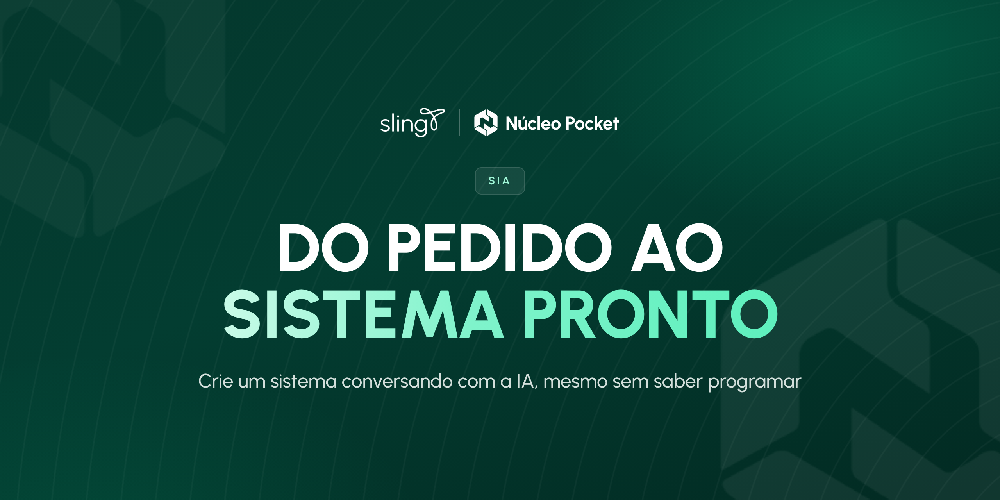
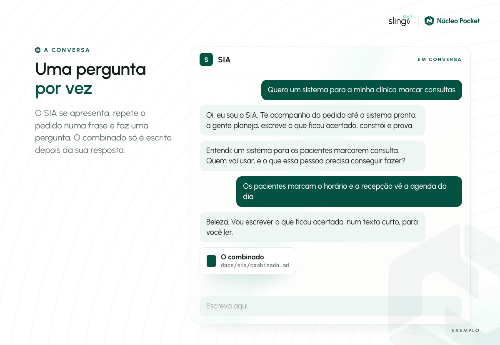
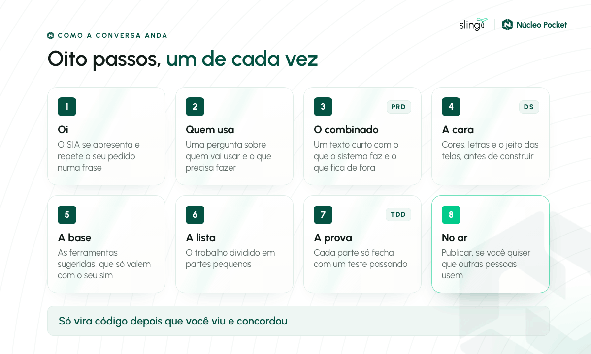
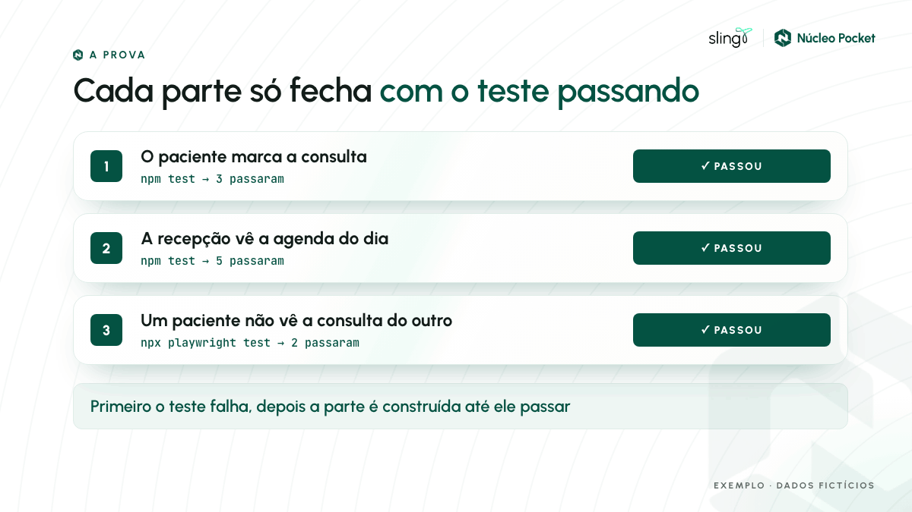
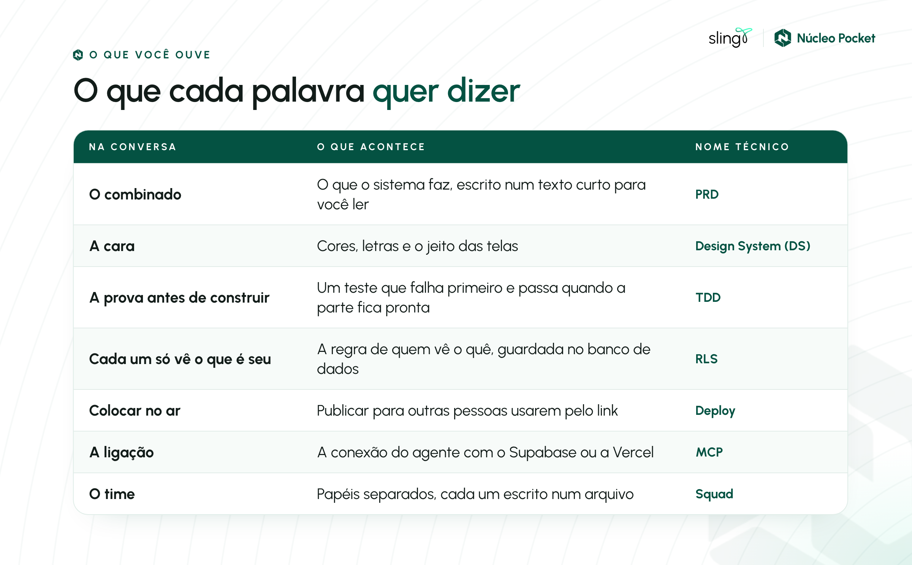

# SIA



Um acompanhante para criar um sistema conversando com a IA, mesmo sem saber programar.

É para você, que conhece o seu negócio e quer tirar uma ideia do papel. A IA faz a parte técnica. Você lê e aprova cada passo.

## O que o SIA faz por você

- Faz uma pergunta por vez, em português simples.
- Escreve o que ficou combinado antes de construir, para você ler e aprovar.
- Só diz que ficou pronto depois de testar.
- Quando algo quebra, procura a causa antes de mexer.

## Antes de começar

- **O Claude Code instalado.** É o programa do Claude que trabalha dentro do seu computador. Ele pede uma conta do Claude nos planos Pro, Max, Team ou Enterprise. O passo a passo oficial, em português, está no [início rápido do Claude Code](https://code.claude.com/docs/pt/quickstart).
- **Saber abrir o terminal.** O terminal é o programa onde se digitam comandos. Se você nunca abriu um, o [guia de terminal](https://code.claude.com/docs/pt/terminal-guide) mostra como, em poucos minutos.
- **Uma pasta vazia para o sistema novo.** Crie uma pasta com o nome do sistema, por exemplo `clinica`, onde preferir. Cada sistema ganha a sua pasta.
- **Os seus arquivos, se tiver.** Planilha, lista de preços, documento da empresa ou regra escrita que o sistema precisa respeitar. Separe agora. O SIA vai pedir para colocar na pasta `docs/contexto/` do projeto antes de escrever o combinado. Esses arquivos não vão para o GitHub. Para escrever o combinado, a IA lê o que está neles, do mesmo jeito que lê o que você escreve na conversa. Não coloque senha nem dado sensível de cliente.

Conta no Supabase (onde os dados do sistema ficam guardados) e na Vercel (onde o sistema fica no ar) só quando o SIA pedir. Não precisa criar antes.

## Instalar

**1. Abra o terminal dentro da pasta do sistema.** Escreva `cd` e um espaço, arraste a pasta para a janela do terminal e aperte Enter.

**2. Adicione o catálogo do SIA.** Cole este comando e aperte Enter. Ele só precisa ser feito uma vez no computador.

```bash
claude plugin marketplace add https://github.com/matt11seven/sia
```

O terminal confirma que o catálogo `sia` foi adicionado.

**3. Ligue o SIA nesta pasta.** Cole e aperte Enter.

```bash
claude plugin install sia@sia --scope project
```

O terminal confirma que o SIA foi instalado no projeto. O SIA fica só nesta pasta. Nas outras pastas do computador, o Claude continua como sempre.

**4. Abra a conversa.** Ainda no terminal, na mesma pasta:

```bash
claude
```

Se o Claude perguntar se você confia nesta pasta, responda que sim.

Para um sistema novo, numa pasta nova, repita os passos 1, 3 e 4.

<details>
<summary>Usa o Codex, o Grok, o Kimi ou o Qwen?</summary>

O SIA também funciona nesses agentes, sempre instalado dentro da pasta do projeto. O passo a passo de cada um está em [docs/install](docs/install).

</details>

## Sua primeira conversa



Escreva o pedido com as palavras do seu negócio. Três exemplos para copiar e adaptar:

- Quero um sistema para a minha clínica marcar consultas.
- Quero um controle de estoque da minha loja que avisa quando um produto está acabando.
- Quero um formulário para os meus clientes pedirem orçamento.

O SIA se apresenta, repete o pedido numa frase e faz uma pergunta. Responda essa. A próxima vem depois.

## Como a conversa anda



1. **Oi.** O SIA se apresenta e repete, numa frase, o que entendeu do pedido.
2. **Quem usa.** Uma pergunta por vez: quem vai usar, o que essa pessoa precisa conseguir fazer e como saber que deu certo.
3. **O combinado.** Um texto curto para você ler: o que o sistema faz, o que fica para depois e como saber que deu certo. Antes de escrever, o SIA pede os seus arquivos da pasta `docs/contexto/` e usa os números e as regras que estão neles.
4. **A cara.** As cores, as letras e o jeito das telas, para você aprovar antes de construir. Se o sistema não tem tela, o SIA só anota isso.
5. **A base.** As ferramentas para construir e guardar os dados. Se o projeto já tem as dele, o SIA segue com elas. Se não tem, ele sugere e espera o seu sim.
6. **A lista.** O trabalho dividido em partes pequenas. Se o sistema tem tela, a primeira parte já é a tela onde o seu "deu certo" acontece. Você escolhe ver parte por parte, ou dizer "vai até o fim" e receber tudo pronto no seu computador.
7. **A prova.** Cada parte só fecha com um teste passando.
8. **No ar.** Só se você quiser que outras pessoas usem. Primeiro um ensaio, com um link para você testar. O definitivo só depois do seu sim.

Só vira código depois que você viu e concordou. Uma mudança pequena, num sistema que já existe, também passa por um combinado curto antes do código.

### A etapa aparece em cada mensagem

Cada mensagem do SIA começa dizendo em que etapa vocês estão. Três delas trazem, ao lado, o nome que você viu nas aulas:

- **Etapa: o combinado (PRD)**
- **Etapa: a cara (Design System, DS)**
- **Etapa: construir, parte 2 de 4 (TDD)**

Na primeira vez que cada nome aparece, o SIA explica o que ele quer dizer.

## Como o SIA prova que ficou pronto



É o TDD que você viu na aula. Antes de construir cada parte, o SIA escreve um teste que confere se aquela parte funciona. No começo o teste falha, porque a parte ainda não existe. A parte só é dada como pronta quando o teste passa.

Você não precisa confiar na palavra da IA. O teste mostra.

## Palavras que você vai ouvir



| Na conversa | O que acontece | Nome técnico |
| --- | --- | --- |
| o combinado | o que o sistema faz, escrito num texto curto para você ler | PRD |
| a cara | cores, letras e o jeito das telas | Design System (DS) |
| a prova antes de construir | um teste que falha primeiro e passa quando a parte fica pronta | TDD |
| cada um só vê o que é seu | a regra de quem vê o quê, guardada no banco de dados | RLS |
| colocar no ar | publicar para outras pessoas usarem pelo link | deploy |
| a ligação | a conexão do SIA com o Supabase ou a Vercel | MCP |
| o time | papéis separados, cada um escrito num arquivo, só quando você pede | squad |
| o contexto | os seus arquivos em `docs/contexto/`, resumidos no combinado | briefing |
| a mesma peça | o botão ou o campo que já existe é usado de novo | componente |

## Quando algo der errado

- **O terminal responde que não conhece o comando `claude`.** O Claude Code ainda não está instalado. Siga o [início rápido do Claude Code](https://code.claude.com/docs/pt/quickstart) e tente de novo.
- **Apertei salvar e sumiu.** Conte ao SIA o que aconteceu, com as suas palavras. Ele procura a causa antes de mexer.
- **A conversa fechou no meio.** Abra de novo na mesma pasta. O SIA lê o que já foi combinado e continua de onde parou, sem repetir as perguntas.
- **Travou e não sei o que fazer.** Fale com a equipe do Núcleo Pocket.

## Perguntas comuns

**Preciso saber programar?** Não. Você responde, lê e aprova. O SIA faz a parte técnica.

**Funciona num sistema que eu já tenho?** Sim. O SIA lê o que já existe e segue as ferramentas que estão lá.

**E se o sistema já tem gente usando?** O SIA pergunta isso antes de mexer no banco de dados. Se tiver, ele pode consultar os dados livremente. Para mudar alguma coisa, explica o efeito e espera o seu sim. Apagar dados só acontece se você pedir uma exclusão específica. Antes, ele guarda uma cópia no banco, com a mesma regra de quem vê, diz em frases o que vai sair e espera o seu sim para aquilo.

**Onde ficam meus dados?** Onde você escolher. O SIA sugere o Supabase, um serviço que guarda as informações e os logins, e só usa com o seu sim.

**Quanto custa?** O SIA é gratuito e de código aberto. O que tem custo é o plano do Claude e, se você usar, as contas do Supabase e da Vercel, que têm planos gratuitos para começar.

## Para quem desenvolve

O caminho por baixo da conversa é sempre o combinado, a cara e a prova. A causa vem antes da correção. Pronto só com um comando rodado na hora. Cada parte fecha com o comando e o resultado escritos. Se a base tiver ESLint e TypeScript, a conferência também roda o lint e a checagem de tipo.

Quando o código nasce, um `AGENTS.md` curto guarda o comando da prova para a sessão seguinte. Ao lado, um `CLAUDE.md` só aponta para ele, porque o Claude lê esse nome. Os arquivos da pessoa ficam em `docs/sia/`. Planilha e documento de fora ficam em `docs/contexto/`. O combinado traz o briefing, não a cópia do arquivo. O resto dessa pasta não vai para o Git, a menos que a pessoa peça.

Toda mensagem dentro de uma etapa abre com `**Etapa: <nome>**`. O combinado leva (PRD), a cara leva (Design System, DS) e a prova e a construção levam (TDD), os nomes das aulas do Núcleo. RLS, migration, deploy e MCP ficam fora da conversa.

O primeiro plano é o pedaço em que o "deu certo" da pessoa acontece. Com tela, a parte 1 abre essa página. Se ela disser que vai até o fim, o agente percorre a lista e a prova sozinho e chama quando estiver pronto na máquina. O sim do combinado e o da cara continuam. Colocar no ar continua sendo outro passo. Se gente já usa o sistema, ler o banco segue. Mudar o banco pede um sim. Apagar dado só pela saída de `dados`: cópia no banco com a mesma regra de quem vê, o que sai em frases sem as linhas, e um sim citando aquilo. Se ela pedir alteração automática, cada mudança nasce com o arquivo que desfaz, em `docs/sia/banco/`.

A mesma conta mora num lugar só. Botão que salva, envia ou apaga não aceita outro clique enquanto a ação corre. O arquivo `.env` fica na máquina. O exemplo, quando o projeto precisa de variável, leva o nome e uma frase, sem o valor. Se o combinado usar uma chamada que cobra por uso, a prova inclui o limite por pessoa. Na hora de colocar no ar, falha crítica ou alta numa dependência segura o link. A pasta que ainda não é um repositório ganha `git init` antes do primeiro código de produto, e esse passo não faz commit.

Na hora da prova, se houver tela web e o projeto ainda não tiver ferramenta, a base sugerida é Next.js, TypeScript, Tailwind, validação na entrada, registro no servidor, Vitest para a regra e Playwright para quem usa e para o sistema. Nada disso é trava. O que já está no projeto ganha, e sem um sim a sugestão não vale. Supabase é a sugestão de dados. Postgres com Drizzle é a segunda, na mesma frase. Vercel é sugestão para colocar uma tela web no ar. Se a pessoa aceitar Supabase, o agente instala a ligação na hora e sobe a mudança do banco por ela. A pessoa não cola SQL num painel.

A instalação é sempre por projeto. No Claude, `--scope project`. Sem esse escopo, o padrão é a conta inteira, e o hook entra em toda pasta. Codex, Grok, Kimi e Qwen seguem a mesma regra, cada um do seu jeito, em [docs/install](docs/install).

No fim da lista, quando o agente consegue chamar outro, a revisão é de um revisor que só lê arquivo e diff. A prova quem roda é a conversa principal. Ele devolve o que é grave, o que é importante e o que é miúdo. Onde não houver esse chamado, a revisão é do mesmo autor, e isso é dito.

O time, quando a pessoa pede papéis do negócio, nasce em `squads/`, em português, no mesmo formato sempre. É texto: esta conversa lê e assume um papel por vez. Construir o sistema continua numa conversa só. Quando o repositório já tem código, o agente monta um mapa de quem chama quem, só do código, nesta máquina, sem hook.

```text
plugins/sia/skills/     as 15 skills, de verdade
plugins/sia/agents/     o revisor, que só lê
skills/                 atalho para a pasta de skills
docs/install/           um arquivo por agente
docs/harness.md         como Claude, Codex, Grok, Kimi e Qwen carregam a mesma biblioteca
docs/readme/            guia de comunicação, imagens deste README e os HTML que as geram
references/SOURCES.md   de onde veio cada instrução, com commit e licença
```

O contrato de cada agente está em [docs/harness.md](docs/harness.md).

### De onde veio

As portas do processo vêm do [Superpowers](https://github.com/obra/superpowers) (MIT). A parada no momento certo vem de três skills do [Caveman](https://github.com/juliusbrussee/caveman) (MIT). A escada do que não construir vem do [Ponytail](https://github.com/dietrichgebert/ponytail) (MIT): o navegador, o banco ou uma linha antes de uma biblioteca nova. A cara das telas opera o buscador do [UI/UX Pro Max](https://github.com/nextlevelbuilder/ui-ux-pro-max-skill) (MIT), limitado a site. Quando a pessoa escolhe Supabase, o agente lê as skills oficiais da Supabase em vez de reinventar regra de banco. Quando escolhe Postgres com Drizzle, a mudança fica num arquivo SQL no projeto. Quando o repositório já tem código, o agente monta um mapa de quem chama quem com a CLI do [Graphify](https://github.com/Graphify-Labs/graphify) (pacote `graphifyy`), só do código, sem hook e sem mandar o mapa para fora.

O motor de compressão do Caveman não entra. A licença dele é outra.

O texto do SIA está na licença MIT deste repositório.

## Quem fez

Criado por Matheus Torres, [@matheustorresna](https://www.instagram.com/matheustorresna/) no Instagram.

O SIA faz parte do Núcleo Pocket, o formato de aulas do Núcleo da Sling para quem quer criar sistemas sem saber programar.
